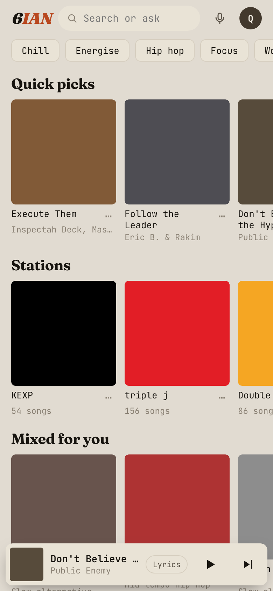
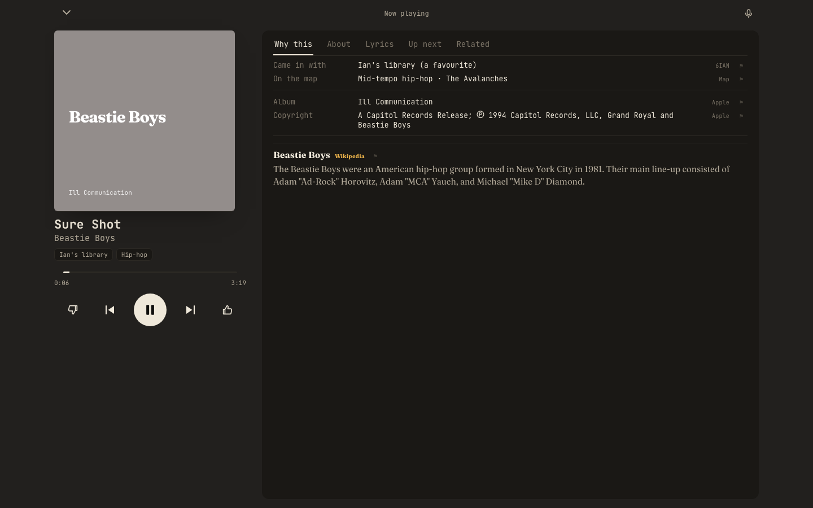

# 6IAN radio

A music-discovery radio for a personal library. It plays from a map of your songs (audio
embeddings), steers with a mood dial and station mixes, takes voice requests, keeps a taste
profile per listener, and grows the library across every era. Each song comes with sourced facts:
why it was picked, album and credits, the artist's Wikipedia summary, and synced lyrics.

| Phone | Desktop |
|---|---|
|  |  |

Album art in these shots is replaced by the app's generated sleeves.

## What it does

- **Home:** tile shelves (mixes, stations, new finds, your library) in the style of YouTube Music.
- **Mood dial and stations:** moods (energise, focus, workout, party, late) and station mixes built
  from public radio playlists, half the station's plays and half its sound on the map.
- **Queue engine** (`lib/engine.ts`): steering on PCA vectors, energy and heaviness axes, era and
  decade variety, an artist gap, a library/new share, time-of-day rules in the listener's zone, and
  a 1-in-10 random control so you can see whether the picks beat chance.
- **Now playing:** a compact player beside a full-height panel: *Why this* (the provenance from
  our own records), *About* (Apple catalogue, MusicBrainz credits and original release year,
  Wikipedia summary), *Lyrics* (LRCLIB, synced to playback), *Up next*, *Related*. Every fact
  carries its source and a one-tap "this is wrong" flag; nothing is written by a language model.
- **Voice:** push-to-talk requests ("play some 90s hip hop", "who is this?", "show lyrics"),
  classified by Gemini, answered by TTS. Music never pauses for the mic.
- **Accounts:** a shared site password, then cookie accounts, magic email links and claim codes.

## Architecture

- **Next.js 15 (App Router) on Vercel.** Audio and covers stream from **Cloudflare R2** through
  presigned URLs and a same-origin proxy. Profiles, counters, and caches are R2 objects updated with
  ETag compare-and-swap.
- **Unified store ([music-core](https://github.com/todd866/music-core)):** shares one R2 contract
  with [Glancebar](https://github.com/todd866/glancebar) and [Onto the TV](https://github.com/todd866/onto-the-tv):
  `music/ids.json` (canonical alias table), `music/facts.json` (sourced MusicBrainz years, LRCLIB
  lyrics IDs, Wikipedia summaries), and `music/taste/` (append-only per-listener event log, written
  directly by 6IAN via CAS in `lib/store.ts`).
- **The map:** `tools/build_space.py` turns 3072-D Gemini audio embeddings into `data/space.json`
  (PCA vectors, t-SNE map, k-means corners). `tools/build_stations.py` maps station playlists onto
  it; `tools/fact_audit.py` cross-checks a random sample against Apple's catalogue each night.
- **An optional home worker** (not included) can fetch requested songs: see
  [docs/acquisition.md](docs/acquisition.md). Bring your own library or acquisition source.

## Setup

1. `npm install`, copy `.env.example` to `.env.local` and fill it in.
2. Put your music in R2 as AAC (`radio/aac/<sha256>.m4a`) with covers (`radio/art/<sha256>.jpg`)
   and a `radio/media.json` index (`{sha: {dur, art, color}}`).
3. Embed the songs and build the map: `python3 tools/build_space.py` (see its docstring for inputs),
   then `python3 tools/years.py` and `python3 tools/build_stations.py`.
4. `npm run dev`, or deploy to Vercel with the same environment variables.

Tests: `npm test` (rules, counters, caps, jobs), `node tests/smoke.mjs <url>` (headless, muted).

## Licence

MIT. Song metadata comes from MusicBrainz (CC0), Apple's public search API, Wikipedia (CC BY-SA,
linked) and LRCLIB; respect their terms and rate limits.
